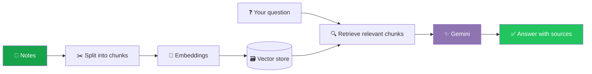

<a name="top"></a>
<div align="center">


<p>
  <a href="https://github.com/balushetty07"></a>
  <a href="https://www.linkedin.com/in/balushetty07"></a>
  <a href="https://note-mind-web.vercel.app"></a>
</p>


<br /><br />

<!-- Quick navigation -->
<a href="#about"></a>
<a href="#terminal"></a>
<a href="#projects"></a>
<a href="#rag"></a>
<a href="#tools"></a>
<a href="#dashboard"></a>
<a href="#connect"></a>

</div>


<a name="about"></a>
## 👋 About Me

I'm an **Electronics and Communication Engineering (ECE) student** at JSS Science and Technology University (formerly SJCE), Mysuru, exploring the intersection of **software development, AI, and electronics**.

| 🤖 **AI** | 💻 **Code** | ⚡ **Electronics** | 🧰 **Workflow** |
|:---:|:---:|:---:|:---:|
| Building RAG & ML apps | Strengthening fundamentals through practice | Core ECE foundations | Clean code, docs, Git/GitHub |

> 💡 *I use this profile to document what I build, what I learn, and how I improve.*

<a name="terminal"></a>
## 💻 Quick Intro (Terminal Style)

```bash
balu@ece-mysuru:~$ whoami
Balu Shetty — ECE Student

balu@ece-mysuru:~$ cat focus.txt
Software Development · AI/RAG · Core Electronics

balu@ece-mysuru:~$ ls projects/
NoteMind-AI/   NoteMind-Web/   spam-classifier/

balu@ece-mysuru:~$ echo $GOAL
Preparing for opportunities in software development and core ECE 🎯

balu@ece-mysuru:~$ _
```


<a name="projects"></a>
## 🚀 Featured Projects

<table>
  <tr>
    <td width="50%" valign="top">
      <h3>🧠 NoteMind-AI</h3>
      <p>A RAG-based study assistant that answers questions from notes with source-grounded responses, built with Python and the Gemini API.</p>
      <p><a href="https://github.com/balushetty07/NoteMind-AI">Source code ↗</a></p>
      <p></p>
    </td>
    <td width="50%" valign="top">
      <h3>💬 NoteMind-Web</h3>
      <p>The web-facing NoteMind project, focused on interface and user experience.</p>
      <p><a href="https://github.com/balushetty07/NoteMind-Web">Source code ↗</a> · <a href="https://note-mind-web.vercel.app">Live website ↗</a></p>
      <p></p>
    </td>
  </tr>
  <tr>
    <td width="50%" valign="top">
      <h3>🛡️ Spam Classifier</h3>
      <p>An AI-powered web app for spam-message detection using NLP and machine learning.</p>
      <p><a href="https://github.com/balushetty07/spam-classifier">Source code ↗</a> · <a href="https://spam-classifier-balushetty07.streamlit.app">Try the demo ↗</a></p>
      <p></p>
    </td>
    <td width="50%" valign="top">
      <h3>⚡ Core ECE Work</h3>
      <p>Building practical work in signals, programming, and electronics. Projects will be added here as they become documented and reproducible.</p>
      <p></p>
    </td>
  </tr>
</table>

<a name="rag"></a>
## 🧠 How NoteMind Works (RAG Flow)



<details>
<summary><b>🔎 What is RAG? (click to expand)</b></summary>
<br />

**Retrieval-Augmented Generation** finds the most relevant parts of your documents first, then lets the AI answer using only that context — so answers stay **grounded in your notes** instead of guessed.

</details>


<a name="tools"></a>
## 🧰 Tools & Technologies

<div align="center">
  
  
  
  
  
  
  
  
  
</div>

<a name="dashboard"></a>
## 📊 GitHub Dashboard

<div align="center">

  
  

  

</div>

<details>
<summary><b>📈 Contribution Activity (click to expand)</b></summary>
<br />
<div align="center">
  
</div>
</details>

<details>
<summary><b>🏆 Profile Trophies (click to expand)</b></summary>
<br />
<div align="center">
  
</div>
</details>

### 🐍 Contribution Snake

<div align="center">

  <picture>
    <source media="(prefers-color-scheme: dark)" srcset="https://raw.githubusercontent.com/balushetty07/balushetty07/output/github-snake-dark.svg" />
    <source media="(prefers-color-scheme: light)" srcset="https://raw.githubusercontent.com/balushetty07/balushetty07/output/github-snake.svg" />
    
  </picture>

</div>

<sub><i>The snake appears after the GitHub Actions workflow runs. Stats cards come from third-party services and may be delayed or temporarily unavailable.</i></sub>


<a name="connect"></a>
## 🤝 Find Me Online

<div align="center">
  <a href="https://github.com/balushetty07"></a>
  <a href="https://www.linkedin.com/in/balushetty07"></a>
  <a href="https://note-mind-web.vercel.app"></a>
  <a href="https://spam-classifier-balushetty07.streamlit.app"></a>
</div>

<br />

<div align="center">

**Learning consistently · Building thoughtfully · Improving through practice** 🌱

<a href="#top"></a>


</div>